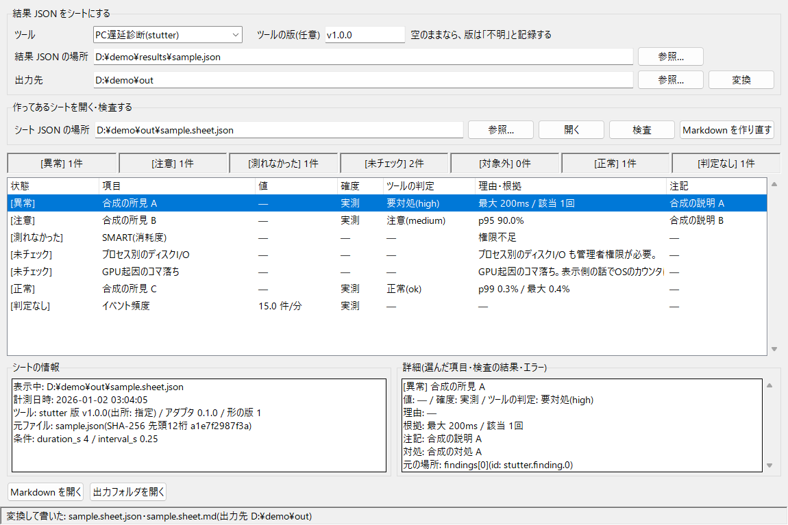
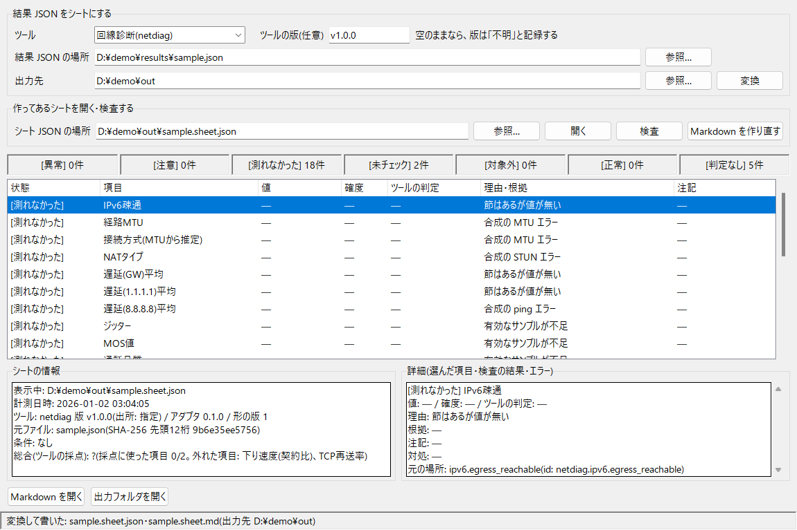
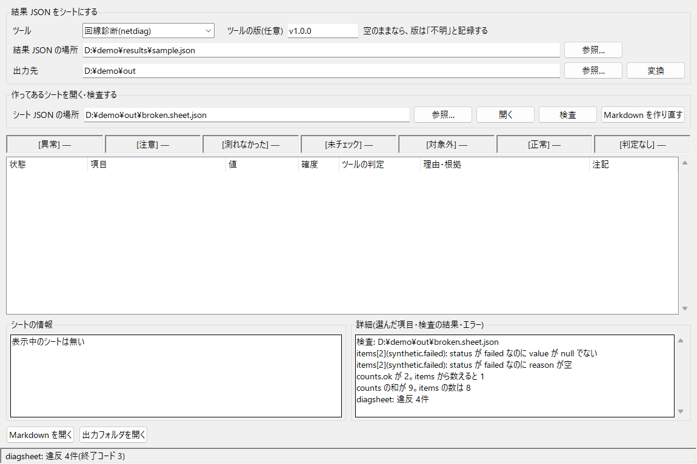

# DiagSheet

診断ツールが保存した結果ファイル(JSON)を読み、同じ形の「シート」に写すツールです。
シートは、機械が読む JSON(`.sheet.json`)と、人が読む Markdown(`.sheet.md`)の2つで1組です。
コマンドライン(CLI)と、同じ処理をボタンから呼ぶ画面(GUI)があります。

対象は次の3本です。3本のコードには手を入れず、import もしません。保存済みの結果ファイルを読むだけです。

| ツール | `--tool` | 状況 |
|---|---|---|
| [PC 遅延診断](https://github.com/takosasi-dev/pc-stutter-diagnosis) v1.0.0 | `stutter` | 実装済み |
| [回線診断](https://github.com/takosasi-dev/Network-diagnostic-software) v1.0.0 | `netdiag` | 実装済み |
| PadLab(コントローラー診断) | `padlab` | 未実装(項目表の確認待ち) |

## GUI



画像はどれも合成データを表示した物で、実測の値ではありません。パスの `¥` は、日本語フォントでの `\` の表示です。

リポジトリの直下で次のように開きます。exe があれば、`DiagSheet.exe` をダブルクリックしても開きます([exe を作る](#exe-を作る))。

```powershell
$env:PYTHONUTF8 = "1"
python -m diagsheet gui
```

GUI は CLI と同じ関数を呼ぶだけです。変換・検査の結果も、エラーの文と終了コードも CLI と同じです。

| 部品 | すること |
|---|---|
| ツール | 結果 JSON を出したツールを選ぶ。PC遅延診断(`stutter`)か回線診断(`netdiag`) |
| ツールの版(任意) | `--tool-version` と同じ。空のままなら、版は「不明」と記録する |
| 結果 JSON の場所・出力先 | 「参照…」で選ぶか、パスを貼る。出力先を空にすると既定の `out\` になる |
| 変換 | `convert` と同じ。`.sheet.json` と `.sheet.md` を書き、書いたシートを読み直して表示する |
| シート JSON の場所 →「開く」 | 作ってあるシートを表示する。`render` と同じ検査を通った物だけを出す(何も書かない) |
| 検査 | `check` と同じ。違反を1行ずつ「詳細」の欄に出す |
| Markdown を作り直す | `render` と同じ。シートの JSON から `.sheet.md` だけを出力先に書く |
| 件数の欄 | 7語を決まった順で出す。0件の語も出す。シートを表示していないときは件数を「—」と書く |
| 一覧 | 項目を7語の順に並べる。状態は `[異常]` のような文字の印で示し、色は付けない |
| シートの情報・詳細 | Markdown の題名の下と同じ行と、選んだ項目の全部の欄(理由・根拠・注記・対処・元の場所) |
| Markdown を開く・出力フォルダを開く | 既定のアプリとエクスプローラーで開く |
| 下端の行 | 結果とエラーを1行で出す。エラーのときは終了コードも書き、窓でも知らせる |

値が無い欄は「—」と書きます。0 や空文字では埋めません。変換や「開く」が途中で止まったときは、前に表示していたシートを消します。

回線診断の結果(測れなかった項目が多い回)と、形の違反があるシートを検査したところです。





## 何をするソフトか

診断ツールは「測れなかった物を、正常と同じに見せない」ことを大事にしています。ところが書き方はツールごとに違い、
同じ「-」が「測れなかった」と「その版には項目が無い」の両方を表すこともあります。

DiagSheet は、どのツールの結果でも同じ7つの語・同じ節の順で読めるようにします。

DiagSheet 自身は**測定も判定もしません**。値を比べる閾値を持たず、判定はツールが結果ファイルに書いた物を
対応表で写すだけです。対応表に無い値が来たら、判定なしにせず変換を止めます。

## 主な機能

- `convert`: 元の JSON を1件読み、`<名前>.sheet.json` と `<名前>.sheet.md` を書く
- `render`: シートの JSON から Markdown だけを作り直す
- `check`: シートの JSON の形を検査し、違反を1行ずつ出す
- `gui`: 上の3つをボタンから呼ぶ画面を開く
- `--selftest`: 合成データだけで検査・描画・各アダプタを通す

### 状態の7語

項目は、値があるか(status)とツールがどう判定したか(verdict)から、次の7つのどれか1つに決まります。
Markdown ではこの順に節を分け、0件の節も「なし」と書いて必ず出します。

| 順 | 表示語 | 意味 |
|---|---|---|
| 1 | 異常 | 値があり、ツールが悪いと判定した |
| 2 | 注意 | 値があり、ツールが注意と判定した |
| 3 | 測れなかった | 測ろうとしたが値が取れなかった(エラーの文・null の値・権限不足など) |
| 4 | 未チェック | 測っていない(その結果ファイルに節が無い、ツールが「測らない」と書いている) |
| 5 | 対象外 | 対象の機器にその部品が無い |
| 6 | 正常 | 値があり、ツールが正常と判定した |
| 7 | 判定なし | 値はあるが、ツールが判定していない |

値が無い項目(3〜5)の値は必ず null で、0・空文字・前回値などで埋めません。理由の文を必ず持ちます。

### 確度の4区分

値がある項目には、値の出し方を1つ付けます。項目ごとに固定で、値の大きさからは決めません。

| 表示語 | 意味 |
|---|---|
| 実測 | ツールがその回に直接測った値と、それだけから計算した数 |
| 参考値 | 標準と違う方法で出した値。ツール自身がそう書いている物に限る(例: 回線診断の簡易RPM近似値) |
| 推定 | 測った値から規則で導いた分類。ツール自身がそう書いている物に限る(例: MTU から推定した接続方式) |
| 申告 | 人が見て・触って答えた値 |

### 写さない物

公開 IP・ISP・市区町村・SSID・MAC アドレス・ゲートウェイの IP・経路・NAT の外部アドレス、
プロセス名・ドライバ名・ディスク名、サンプルの生データは、シートに写しません。
ただし、元のツールが所見の題名や理由の文に書いた語は、そのまま写ります。人に渡す前に Markdown を読んで確かめてください。

## 動作環境

- Windows 11
- Python 3.11 以上
- 標準ライブラリだけで動きます(追加のインストールは不要)。GUI も標準の tkinter です。ネットワーク通信はしません

## 使い方

リポジトリの直下で実行します。Windows では、日本語が文字化けしないように `PYTHONUTF8=1` を付けます。

```powershell
$env:PYTHONUTF8 = "1"

# PC 遅延診断の結果を変換する
python -m diagsheet convert --tool stutter C:\path\to\results\idle_20260102_030405.json

# 回線診断の結果を、ツールの版を付けて変換する
python -m diagsheet convert --tool netdiag C:\path\to\results\test_20260102_030405.json --tool-version v1.0.0

# 出力先を変える
python -m diagsheet convert --tool stutter C:\path\to\idle.json --out D:\sheets

# シートの JSON から Markdown だけを作り直す / 形を検査する
python -m diagsheet render out\idle_20260102_030405.sheet.json --out D:\sheets
python -m diagsheet check  out\idle_20260102_030405.sheet.json

# 画面を開く
python -m diagsheet gui

# 自己テスト
python -m diagsheet --selftest
```

- 出力の名前は、元のファイル名から拡張子を除いた物です。出力先の既定はリポジトリ直下の `out\` です(exe では exe の隣の `out\`)
- 同じ名前のファイルがあれば、上書きせずに止まります
- 出力先が診断ツールのフォルダ(`diagsheet\mappings\tool_dirs.json`)の中なら、何も書かずに止まります
- ツールの版は結果ファイルに書かれていないので、`--tool-version` で与えます。付けなければ「不明」と記録します(推定はしません)

| 終了コード | 意味 |
|---|---|
| 0 | 正常 |
| 1 | 引数・入出力のエラー(読めない JSON、同名ファイルあり、まだ無いアダプタ) |
| 2 | 知らない形、対応表に無い判定の値 |
| 3 | `check` の違反、知らない形の版 |
| 4 | 出力先が診断ツールのフォルダの中 |

終了コードが 0 以外のときは、出力ファイルを1つも残しません。

### 対応表(仮決め)

`diagsheet\mappings\` の JSON が、判定の写し方を決めています。**2026-10-13 時点の値は仮決めで、確認待ちです。**

| ファイル | 中身 |
|---|---|
| `verdict_map.json` | ツールの判定 → 共通の判定。PC 遅延診断は `severity` の high→異常 / medium→注意 / ok→正常。回線診断は `jitter.quality` の先頭1文字(優・良→正常 / 可→注意 / 不→異常)と `dnsbl.has_problem`(true→異常 / false→正常)。「異常」の表示語もここで決める |
| `not_measured.json` | ツールが README で「測れないもの」と書いている物のうち、未チェックとして出す物。PC 遅延診断の「プロセス別のディスクI/O」「GPU起因のコマ落ち」 |
| `tool_dirs.json` | 書き込みを拒否する、診断ツール3本のフォルダ |

回線診断の項目のうち、判定が付くのは対応表にある「通話品質」と「DNSBL問題あり」の2つだけです。
バッファブロートなど、結果ファイルに判定が書かれていない項目は「判定なし」になります。

## exe を作る

Python を入れていない PC でも使えるように、1ファイルの exe にできます。作るときだけ PyInstaller が要ります。

```powershell
python -m pip install pyinstaller
python tools\build_exe.py
```

`dist\DiagSheet.exe` ができます(約 10 MB)。作業ファイルと `.spec` は `build\` の下に置きます。

- exe はリポジトリに入れていません(`dist/` と `build/` は `.gitignore` で外しています)。ビルド済みの exe は [Releases](https://github.com/takosasi-dev/diag-sheet/releases) から取れます。自分で作るときは上のコマンドを使います
- 署名していない exe なので、ほかの PC へ持っていくと SmartScreen の警告が出ることがあります
- 引数なしで開く(ダブルクリックする)と GUI が開きます。起動のたびに一時フォルダへ展開するので、開くまで 1〜2 秒かかります
- 引数を付けると CLI として動きますが、コンソールには何も出ません。結果は終了コードと出力ファイルで確かめます
- 既定の出力先は exe の隣の `out\` です。展開先の一時フォルダには書きません
- 対応表は exe に同梱した物だけを使います。exe の隣に `mappings\` を置いても読みません。変えるときは JSON を直して exe を作り直します

```powershell
# exe を CLI として使い、終了コードを見る
$p = Start-Process .\dist\DiagSheet.exe -ArgumentList 'check','out\idle_20260102_030405.sheet.json' -Wait -PassThru
$p.ExitCode
```

## 開発状況

版 0.2.0(シートの形の版は 1。アダプタの版は 0.1.0 のまま)。

実装済み:

- シートの形と検査、Markdown の描画、出力の安全(上書きしない・途中で失敗したら何も残さない)
- PC 遅延診断アダプタ。公開版 v1.0.0 の実物の結果1件(SMART が取れなかった回)で、所見の件数と判定の件数が元のレポートと一致することを確かめた
- 回線診断アダプタ。公開版 v1.0.0 の実物の結果1件で、総合のグレードと点が元の JSON と一致し、公開 IP と SSID がシートに出ないことを確かめた
- GUI(tkinter)。変換・シートの表示・検査・Markdown の作り直しを、CLI と同じ関数で行う
- exe のビルド(PyInstaller の1ファイル形式)。合成データで、GUI が開くことと、CLI として変換・検査できて終了コードが合うことを確かめた

実物が無いので、確かめていない・作っていない物:

- PadLab アダプタ(未実装)。`--tool padlab` は終了コード 1 で止まる。GUI のツールの欄には出さない
- PC 遅延診断の旧形式(ドライブ別に分かれる前の `disk_read_s` だけの結果)。渡すと終了コード 2 で止まる
- PC 遅延診断で SMART が取れた回と、開けなかった PDH カウンタがある回。公開版のコードから読んだ形で実装し、合成データでだけ確かめた
- 回線診断の v1.0.0 より前の結果。「上位の節が無ければ未チェック」の規則は合成データでだけ確かめた。古い実物では未確認
- 手元で動かしている2本が公開版 v1.0.0 と同じかどうかは未確認。違う鍵があれば「知らない形」で止まる
- exe は作った PC(Windows 11)でだけ動かした。ほかの PC と、Python を入れていない PC では未確認

やらないと決めていること: 判定や閾値を足すこと、時系列の比較、定期実行、状態の色分け、診断ツール側のコードの変更。

### 仕様書との違い

- 仕様書 v1 は GUI を非スコープにしている。0.2.0 の GUI と exe は、依頼者の指示で足した
- 足したのは画面と入口だけ。GUI は CLI と同じ関数を呼び、判定・閾値・値の代用・状態の色分けは足していない
- exe は Releases に添付している(リポジトリには入れていない)

## 開発

```powershell
python -m ruff check .
python -m mypy --strict diagsheet
python -m pytest
python -m diagsheet --selftest
```

テストの検体は `tests\fixtures\` の合成データだけです。実測の結果ファイルはリポジトリに入れません。
GUI のテストは窓を隠したまま作り、Tk が動かない環境では飛ばします。

`tools\` の2本は開発用で、動かすときだけ追加のパッケージが要ります。

```powershell
python tools\build_exe.py          # exe を作る(PyInstaller)
python tools\make_screenshots.py   # README の画像を合成データで撮り直す(Pillow)
```

## ライセンス

[MIT License](LICENSE)
